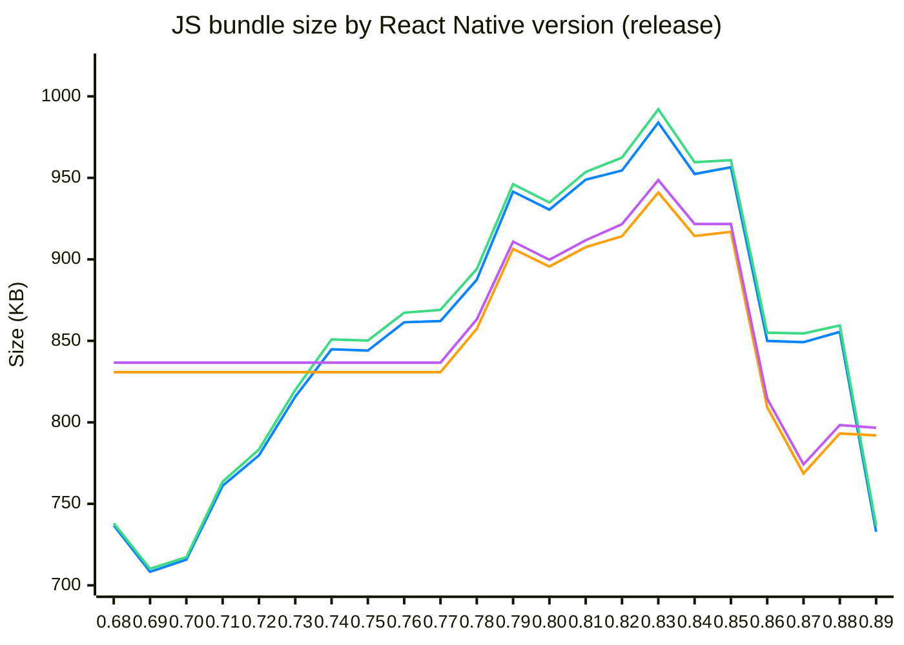

# React Native Bundle Diffs

How much does the JS bundle of a **brand-new React Native app** grow from one RN version to the next, and what changed inside it?

This repo creates an empty app from the official template for every React Native version, builds a release JS bundle for iOS and Android, and publishes a module-by-module diff between consecutive versions. Bundles are built with **Metro** (the default bundler) and **Re.Pack** (Rspack).

> [!TIP]
> Every number and report here was generated with **[react-native-bundle-discovery](https://github.com/retyui/react-native-bundle-discovery)**, a tool for exploring React Native bundle size: heavy packages, module structure and diffs between builds. It works with Metro and Re.Pack. Try it on your own app.

## Results

### Metro + Re.Pack

Release JS bundle size (`--dev false`) of a new app, per platform:

🔵 Metro `ios` · 🟢 Metro `android` · 🟠 Re.Pack `ios` · 🟣 Re.Pack `android`

Re.Pack is measured from `0.77.x`; before that its lines repeat the `0.77.x` value.

| Bundler | Platform | First | Last | Overall Δ | Peak |
| --- | --- | ---: | ---: | ---: | ---: |
| Metro | `ios` | 736.76 KB (`0.68.x`) | 732.85 KB (`0.89.x`) | 📉 -3.91 KB (-0.53%) | 983.93 KB (`0.83.x`) |
| Metro | `android` | 738.14 KB (`0.68.x`) | 736.54 KB (`0.89.x`) | 📉 -1.59 KB (-0.22%) | 992.06 KB (`0.83.x`) |
| Re.Pack | `ios` | 830.81 KB (`0.77.x`) | 791.99 KB (`0.89.x`) | 📉 -38.82 KB (-4.67%) | 941.03 KB (`0.83.x`) |
| Re.Pack | `android` | 836.66 KB (`0.77.x`) | 796.68 KB (`0.89.x`) | 📉 -39.98 KB (-4.78%) | 948.63 KB (`0.83.x`) |

### Reports

Size change between consecutive versions. Each link opens the full report: size change, added and removed modules, and package version bumps. Re.Pack is only measured from `0.77.x` (see [Supported versions](#supported-versions)).

| From → To | Metro iOS | Metro Android | Re.Pack iOS | Re.Pack Android |
| --- | --- | --- | --- | --- |
| `0.68.x` → `0.69.x` | [📉 -28.42 KB (-3.86%)](./reports/metro/RN68-RN69-ios.md) | [📉 -27.96 KB (-3.79%)](./reports/metro/RN68-RN69-android.md) | — | — |
| `0.69.x` → `0.70.x` | [📈 +7.42 KB (+1.05%)](./reports/metro/RN69-RN70-ios.md) | [📈 +7.1 KB (+1%)](./reports/metro/RN69-RN70-android.md) | — | — |
| `0.70.x` → `0.71.x` | [📈 +45.34 KB (+6.33%)](./reports/metro/RN70-RN71-ios.md) | [📈 +46.33 KB (+6.46%)](./reports/metro/RN70-RN71-android.md) | — | — |
| `0.71.x` → `0.72.x` | [📈 +18.63 KB (+2.45%)](./reports/metro/RN71-RN72-ios.md) | [📈 +19.74 KB (+2.59%)](./reports/metro/RN71-RN72-android.md) | — | — |
| `0.72.x` → `0.73.x` | [📈 +36.01 KB (+4.62%)](./reports/metro/RN72-RN73-ios.md) | [📈 +36.52 KB (+4.66%)](./reports/metro/RN72-RN73-android.md) | — | — |
| `0.73.x` → `0.74.x` | [📈 +29.1 KB (+3.57%)](./reports/metro/RN73-RN74-ios.md) | [📈 +31.03 KB (+3.78%)](./reports/metro/RN73-RN74-android.md) | — | — |
| `0.74.x` → `0.75.x` | [📉 -829 Bytes (-0.1%)](./reports/metro/RN74-RN75-ios.md) | [📉 -765 Bytes (-0.09%)](./reports/metro/RN74-RN75-android.md) | — | — |
| `0.75.x` → `0.76.x` | [📈 +17.38 KB (+2.06%)](./reports/metro/RN75-RN76-ios.md) | [📈 +17.12 KB (+2.01%)](./reports/metro/RN75-RN76-android.md) | — | — |
| `0.76.x` → `0.77.x` | [📈 +727 Bytes (+0.08%)](./reports/metro/RN76-RN77-ios.md) | [📈 +1.75 KB (+0.2%)](./reports/metro/RN76-RN77-android.md) | — | — |
| `0.77.x` → `0.78.x` | [📈 +25.39 KB (+2.95%)](./reports/metro/RN77-RN78-ios.md) | [📈 +25.01 KB (+2.88%)](./reports/metro/RN77-RN78-android.md) | [📈 +26.6 KB (+3.2%)](./reports/repack/RN77-RN78-ios.md) | [📈 +26.52 KB (+3.17%)](./reports/repack/RN77-RN78-android.md) |
| `0.78.x` → `0.79.x` | [📈 +54.03 KB (+6.09%)](./reports/metro/RN78-RN79-ios.md) | [📈 +52.15 KB (+5.83%)](./reports/metro/RN78-RN79-android.md) | [📈 +49.03 KB (+5.72%)](./reports/repack/RN78-RN79-ios.md) | [📈 +47.7 KB (+5.53%)](./reports/repack/RN78-RN79-android.md) |
| `0.79.x` → `0.80.x` | [📉 -11.09 KB (-1.18%)](./reports/metro/RN79-RN80-ios.md) | [📉 -11.29 KB (-1.19%)](./reports/metro/RN79-RN80-android.md) | [📉 -10.85 KB (-1.2%)](./reports/repack/RN79-RN80-ios.md) | [📉 -11.12 KB (-1.22%)](./reports/repack/RN79-RN80-android.md) |
| `0.80.x` → `0.81.x` | [📈 +18.42 KB (+1.98%)](./reports/metro/RN80-RN81-ios.md) | [📈 +18.73 KB (+2%)](./reports/metro/RN80-RN81-android.md) | [📈 +11.89 KB (+1.33%)](./reports/repack/RN80-RN81-ios.md) | [📈 +11.98 KB (+1.33%)](./reports/repack/RN80-RN81-android.md) |
| `0.81.x` → `0.82.x` | [📈 +5.62 KB (+0.59%)](./reports/metro/RN81-RN82-ios.md) | [📈 +8.82 KB (+0.92%)](./reports/metro/RN81-RN82-android.md) | [📈 +6.66 KB (+0.73%)](./reports/repack/RN81-RN82-ios.md) | [📈 +9.81 KB (+1.08%)](./reports/repack/RN81-RN82-android.md) |
| `0.82.x` → `0.83.x` | [📈 +29.44 KB (+3.08%)](./reports/metro/RN82-RN83-ios.md) | [📈 +29.63 KB (+3.08%)](./reports/metro/RN82-RN83-android.md) | [📈 +26.89 KB (+2.94%)](./reports/repack/RN82-RN83-ios.md) | [📈 +27.08 KB (+2.94%)](./reports/repack/RN82-RN83-android.md) |
| `0.83.x` → `0.84.x` | [📉 -31.55 KB (-3.21%)](./reports/metro/RN83-RN84-ios.md) | [📉 -32.46 KB (-3.27%)](./reports/metro/RN83-RN84-android.md) | [📉 -26.71 KB (-2.84%)](./reports/repack/RN83-RN84-ios.md) | [📉 -26.9 KB (-2.84%)](./reports/repack/RN83-RN84-android.md) |
| `0.84.x` → `0.85.x` | [📈 +4.11 KB (+0.43%)](./reports/metro/RN84-RN85-ios.md) | [📈 +1.27 KB (+0.13%)](./reports/metro/RN84-RN85-android.md) | [📈 +2.58 KB (+0.28%)](./reports/repack/RN84-RN85-ios.md) | [📉 -38 Bytes (0%)](./reports/repack/RN84-RN85-android.md) |
| `0.85.x` → `0.86.x` | [📉 -106.51 KB (-11.14%)](./reports/metro/RN85-RN86-ios.md) | [📉 -105.89 KB (-11.02%)](./reports/metro/RN85-RN86-android.md) | [📉 -107.59 KB (-11.73%)](./reports/repack/RN85-RN86-ios.md) | [📉 -107.23 KB (-11.63%)](./reports/repack/RN85-RN86-android.md) |
| `0.86.x` → `0.87.x` | [📉 -804 Bytes (-0.09%)](./reports/metro/RN86-RN87-ios.md) | [📉 -456 Bytes (-0.05%)](./reports/metro/RN86-RN87-android.md) | [📉 -40.67 KB (-5.03%)](./reports/repack/RN86-RN87-ios.md) | [📉 -40.26 KB (-4.94%)](./reports/repack/RN86-RN87-android.md) |
| `0.87.x` → `0.88.x` | [📈 +6.29 KB (+0.74%)](./reports/metro/RN87-RN88-ios.md) | [📈 +4.88 KB (+0.57%)](./reports/metro/RN87-RN88-android.md) | [📈 +24.56 KB (+3.2%)](./reports/repack/RN87-RN88-ios.md) | [📈 +24.14 KB (+3.12%)](./reports/repack/RN87-RN88-android.md) |
| `0.88.x` → `0.89.x` | [📉 -122.63 KB (-14.34%)](./reports/metro/RN88-RN89-ios.md) | [📉 -122.87 KB (-14.3%)](./reports/metro/RN88-RN89-android.md) | [📉 -1.21 KB (-0.15%)](./reports/repack/RN88-RN89-ios.md) | [📉 -1.66 KB (-0.21%)](./reports/repack/RN88-RN89-android.md) |

## Supported versions

| Bundler | React Native versions | Notes |
| --- | --- | --- |
| Metro | `0.68.x` – `0.89.x` | Every version in `rn-versions.json` |
| Re.Pack | `0.77.x` – `0.89.x` | Re.Pack's [minimum is 0.77](https://re-pack.dev/docs/getting-started/quick-start) |

The Re.Pack range is set in [`scripts/get-versions.mjs`](./scripts/get-versions.mjs). From RN `0.79`, Re.Pack's `enablePackageExports` is turned on to match Metro's default module resolution, so the two bundlers resolve the same files.

Since RN `0.89`, `react-native bundle` uses the `hermes-stable` transform profile by default, for which Metro skips minification. [`patches/metro-transform-worker.patch`](./patches/metro-transform-worker.patch) is applied before building RN `0.89+` so its bundles are minified like the older ones.

## Adding a React Native version

1. Add an entry to [`scripts/rn-versions.json`](./scripts/rn-versions.json), e.g. `{ "id": "RN89", "version": "0.89.0" }`.
2. If the new version works with Re.Pack, raise `REPACK_MAX_MINOR` in [`scripts/get-versions.mjs`](./scripts/get-versions.mjs).
3. Build it (locally or on CI) and run `compare-reports`.
4. Update the chart, the tables and the report links in this README.
